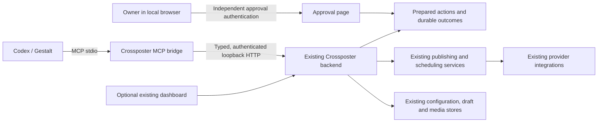

# Crossposter MCP architecture decision

Working analysis, 2 November 2026. This document records architecture evidence,
product decisions, and the implementation contract for the MCP planning session.
It is an engineering decision record, not a record of private reasoning.

## Objective and confirmed requirements

Operate Crossposter through MCP for the complete daily publishing workflow:
discover accounts and readiness, manage media and the existing draft, prepare
posts, publish, manage schedules, and inspect results. The first release is
local, for one owner. Preparing a publication or schedule must precede an
explicit user confirmation. Accounts are already configured: onboarding stays
with the existing setup/sign-in flows for the first release. The first
acceptance client is Codex / Gestalt.
Confirmation must be recorded through a separate local approval surface, not
merely asserted by the agent in chat. Browser interaction is also acceptable
when a provider requires sign-in. Implementation is not authorized by this
planning session.

## Evidence baseline

- Crossposter repository: `https://github.com/dyne/crossposter`, inspected at
  `15ff040`, package version `1.1.16`. Planning branch: `feat/mcp-control`.
- Supplied bundle: `Zernio_MCP_Complete_Reference_Bundle.zip`, SHA-256
  `060ee6e51eba749aae157695ab9312ae15e24f0db3062efe22d92ba256852783`.
  It contains 25 files, 42,615,981 uncompressed bytes. The narrative report has
  1,914 extracted paragraphs; catalogs and evidence supplement the report.
- Reference extraction: workspace `.gestalt/references/zernio/`.
  Narrative locators below refer to paragraph numbers in
  `report/architecture-extracted.txt`, extracted from the supplied DOCX.
- The bundle pins Zernio's public Python SDK at
  `d52b70552e0bcb2ddf8c1372902457c94df51200`; its backend implementation is
  outside that evidence. No authenticated Zernio operation is claimed tested.
- All 24 manifest-listed files passed size and SHA-256 verification. Counts
  independently parsed from the supplied JSON: 1,135 REST operations, 528
  component schemas, 1,155 registered backing tools, 54 initially visible
  generic tools, 1,157 distinct generic schema records including discovery,
  13 curated tools, and 3 documentation tools. Mapping limitations contain
  49 affected tool records. These are snapshot counts, not live deployment
  attestations.
- XERJ supplied Crossposter locators from its 30 October catalog. All claims
  about local behavior here were checked against current files; the retrieval
  catalog alone did not establish repository freshness or behavior.

## Decision: extend Crossposter in the existing codebase

Extend Crossposter in its current repository. Give it a small, curated MCP
adapter and make narrow additions to the existing backend where its HTTP
surface is insufficient. Retain one owner of provider execution, storage and
scheduling. A new independent publishing backend would duplicate the mature
parts of Crossposter and still need the same correctness work.

The process arrangement is a stdio MCP bridge talking over loopback
to the existing Crossposter backend. The bridge must not import production
storage/provider facades or start a second scheduler. This separates the MCP
client lifetime from the scheduled-post service lifetime. Keep the existing
dashboard available; normal MCP operation does not require opening it. The
approval screen is a deliberately narrow human checkpoint.

| Option | Benefits | Cost and risk | Decision |
| --- | --- | --- | --- |
| Extend the current backend with a curated MCP bridge | Reuses 11 providers, profile resolution, media store, scheduler, deployment and regression harness | Requires a small typed control API and specific reliability changes | Recommended |
| Add an in-process MCP entry that imports all production facades | Direct calls avoid loopback transport | A client-launched process could share JSON files and run a second scheduler; Next `server-only` and bundler assumptions complicate startup | Reconsider only if a future headless runtime replaces the backend as the sole owner |
| Start an independent MCP publishing codebase | Full freedom to redesign runtime and persistence | Copies provider maintenance, credentials, media, schedules, migrations, tests and operational knowledge; also needs new approval and replay handling | Not justified by the local single-owner requirement |

The loopback HTTP hop is a deployment boundary between processes, not a rule
that application services must call themselves through HTTP. Backend routes
invoke the existing injected services directly. If remote multi-user operation
later becomes a requirement, revisit identity, tenancy, storage and workers in
a new decision; do not prebuild those systems now.

## Findings already verified against current Crossposter source

| Finding | Current evidence | Design implication |
| --- | --- | --- |
| Publishing already has an injected use case and provider registry | `lib/publishing/service.ts`, `lib/publish-runner.ts`, `lib/providers/index.ts` | Reuse business execution; do not reimplement providers in MCP. |
| Routes mix orchestration with transport in some features | `app/api/scheduled/route.ts`, `app/api/scheduled/[id]/route.ts`, `app/api/draft/route.ts` | Extract only the operations required by the new adapter. |
| Config GET returns field values and entire profiles | `app/api/config/route.ts:48` | Never expose this payload as an account discovery tool; build a secret-free projection. |
| Readiness currently checks configured fields, by platform | `app/api/readiness/route.ts:12` | Distinguish configured readiness from verified provider authentication and per-profile readiness. |
| Scheduled collection GET starts and runs a tick | `app/api/scheduled/route.ts:39` | An MCP read tool cannot simply proxy this route and advertise itself as read-only. |
| Claiming permits already-publishing entries from stale snapshots | `lib/scheduling/service.ts:32` | Correct claim eligibility for the new operating model, with controlled interleaving regressions. |
| Any successful schedule target causes queue removal | `lib/scheduling/service.ts:82` | Preserve per-target outcomes durably and never retry successful destinations implicitly. |
| Provider exceptions can carry uncertainty | `lib/publishing/service.ts:112` | Surface uncertainty as structured state; never blindly retry ambiguous writes. |
| One persisted composer draft exists | `app/api/draft/route.ts`, `lib/types.ts:48` | Do not promise a multi-draft library without a separate product decision. |
| History normalization drops the uncertainty flag | `lib/storage/codec-helpers.ts:79` | Preserve it compatibly and make the action journal authoritative for MCP outcomes. |
| JSON writes directly overwrite the file and parse errors return empty defaults | `lib/storage/json-storage.ts:19`, `lib/storage/config-store.ts:43` | Use atomic durable action storage, and fail closed rather than replacing unreadable state during control operations. |
| Headless ticking already exists | `bin/crossposter.mjs:401`, `app/api/health/route.ts:5` | Reuse launcher warmup/pings and backend timer; verify lifecycle rather than inventing a new worker. |
| Launcher currently defaults to all interfaces and may update/open a browser | `bin/crossposter.mjs:288`, `bin/crossposter.mjs:381` | Give the new MCP path explicit loopback/no-open/no-update behavior and keep stdout exclusively for MCP. |

## Zernio patterns to adopt or reject

- Adopt its adapter boundary: MCP dispatch invokes existing application/API
  operations; platform integrations and scheduler remain backend-owned
  (report paragraphs 125–153).
- Prefer the curated interface pattern: 13 typed tools on Zernio's separate
  curated surface, rather than copying its 1,155-tool backing registry and
  BM25 discovery machinery (25–81, 154–179).
- Use stable explicit target identifiers and reject ambiguity. A display name
  is neither an identity nor an authorization boundary.
- Preserve exact requested mode, targets, absolute scheduled instant, returned
  identifiers, warnings and per-target outcomes. An HTTP success or readable
  success string does not establish publication (161–166, 1061–1099).
- Avoid silent defaults: Zernio's helper schedules an hour ahead while REST
  defaults to a draft. Crossposter tools must have explicit preparation modes.
- Avoid generic schema generation initially. The bundle identifies omitted
  multipart arguments and omitted idempotency headers; advertised coverage is
  not sufficient evidence of executable contracts (75–78).
- Keep binary transfer outside ordinary text tool arguments. For local use,
  stream an explicitly selected local file into Crossposter's existing media
  store and return a media identifier (1100–1106).
- A request ID alone does not give duplicate protection across independent
  tool calls. Confirmation and execution need durable backend state, payload
  binding, and conservative recovery after uncertain provider outcomes.

## Target process and dependency boundaries



- Keep bridge source under `mcp/` in the same repository and npm package. Add a
  `crossposter-mcp` executable rather than routing through the launcher's normal
  banner/update path. Compile the bridge for Node; do not depend on Next's
  transpiler or production `tsx` execution.
- Put backend control contracts/use cases under `lib/control/` and explicit
  route adapters under `app/api/mcp/v1/`. These proposed names are implementation
  starting points. Reuse `lib/publishing/`, `lib/scheduling/` and `lib/storage/`;
  extract small operations from routes where necessary.
- One Crossposter backend owns the data root. Multiple MCP clients may attach
  to that backend; a bridge never reads/writes provider configuration or queue
  files directly. Enforce backend ownership before control writes, detect a
  second writer for the same data root, and test restart/stale-owner handling.
- MCP attachment does not install services, restart an existing backend, scan
  ports, or open browsers. It connects to an explicitly configured loopback
  endpoint. Missing/mismatched backend identity yields a useful error and the
  exact headless launch command. The persistent backend is started separately
  through the existing launcher/service mechanism.
- MCP EOF stops the bridge. Already approved durable schedules remain with
  the backend. The backend must remain running to publish on time; after host
  downtime, overdue approved schedules follow the documented catch-up policy.

The persistence boundary now lives in `lib/control/backend-ownership.ts`,
`backend-mutation.ts` and `action-store.ts`. Control-enabled production paths,
including optional dashboard writes, share a canonical-root owner claim and
fail before effects on ownership loss or unreadable config/journal state. A live
or reused PID is never reclaimed; a confirmed absent PID can be recovered under
a serialized recovery gate. Immutable journal records and terminal replay links
use private files, file flush, atomic replacement and directory flush. A durable
initialization marker makes a disappeared journal an explicit error after
restart. Pure GETs initialize none of this state. Existing behavior is retained
when no control setup or retained control artifacts exist. This boundary enables
neither an approval decision nor provider execution; see
`lib/storage/README.md` for recovery and filesystem limitations.

The reader/writer JSON ceiling is shared and counts the complete serialized
UTF-8 output before replacement; overflow preserves existing records and cannot
initialize an oversized first journal. Accepted `scheduled` / `rescheduled`
records remain eligible for later dispatch/result transitions under the same
immutable action identity, including after the preparation deadline. Truly final
outcomes cannot return to execution. These storage semantics grant no approval
or publishing authority by themselves.

`prepare_action` and `get_action` now use the existing backend through authenticated
`POST /actions` and pure `GET /actions/:actionId`. Preparation performs no provider,
timer or enqueue operation. It canonicalizes accepted input through the incumbent
URL/publishing normalization, validates each explicit publication profile separately and saves
the full immutable preview with a thirty-minute deadline. The stable request key
replays that retained record across backend restart, including expired/conflicting
records; a changed canonical request conflicts. Reads derive expiry and changed
preconditions without repairing or updating storage. No owner-decision or commit
route is enabled by this milestone.

Publication/rescheduling account binding is deliberately conservative: public identity revisions describe
the public target/action snapshot and never hash credentials. A backend-private
HMAC binds effective explicit-profile or explicit-base settings, configured local
session state and relevant cookie/login/storage bytes. Automatic YouTube Chrome
sources and its incumbent stored-cookie fallback are bound without extracting
credentials or checking a provider login. A legacy base target never follows an
active profile. Changed session/configuration, actual stored media bytes, or a
relevant draft/schedule revision invalidates preparation. The backend rechecks
these conditions and the clock after media IO before saving. Future execution
must use the same explicit resolver and private binding, not the legacy active
profile fallback for an undefined profile ID.

Scheduled inputs require an explicit offset and a future instant, normalize to
UTC, and display the frozen IANA timezone selected by `CROSSPOSTER_TIMEZONE`
(default `Europe/Berlin`). Cancellation previews retain the existing queue time;
cancellation can still prevent overdue pending work. Cancellation requires an
existing scheduled/failed item and its expected revision, but never publication
readiness, live session access or readable media bytes. Its safe retained preview
marks account/media references unverified and omits unsafe links. The private
`cancellationQueueBindings` snapshot binds the raw queue identity/state, including
changes hidden by redaction, rather than live account settings or label fallbacks.
Later cancellation commit must independently approve and recheck this queue binding;
deleting credentials/media alone must not revoke the ability to stop the item.
Missing/changed publication bindings are conservative conflicts, not a claim that
authentication succeeded.
The valid title-only Dribbble/Pinterest schedule persistence disagreement is now
repaired narrowly, with unrelated legacy normalization retained.

## Frozen first-release tool contract (control API v1)

Expose a bounded catalog directly. No hidden-tool search, unrestricted HTTP
proxy, arbitrary code executor, or generic `call_tool` dispatcher is needed.
The thirteen names below are frozen by `lib/control/contracts.ts`. Every input
and output object rejects unknown properties, including nested objects. This
catalog defines future mutations without enabling their handlers in the read
milestone. All routes below are relative to `/api/mcp/v1`.

Each catalog entry also exposes `publishedInputSchema`, generated with input
semantics (so defaulted arguments stay optional) and an explicit `type: "object"`
root. The publication mapping preserves `prepare_action`'s four strict composed
variants. The later SDK registration must use this published schema rather than
unwrapped union conversion. This follows the [MCP object-root requirement](https://blog.modelcontextprotocol.io/posts/2026-07-28-release-candidate/#full-json-schema-2020-12-for-tools).

| Tool | Purpose | Consequences |
| --- | --- | --- |
| `get_status` | Backend/API version, instance identity, scheduler and approval setup status | Pure read; no provider health claim |
| `list_targets` | Stable IDs, platform, account label, configuration readiness and supported capabilities | Secret-free read; no implicit active-account selection |
| `get_draft` | Read the existing single draft and revision | Pure read |
| `save_draft` | Replace that draft with an expected revision | Local mutation; stale edits conflict |
| `clear_draft` | Clear the single draft with an expected revision | Local destructive mutation; no history deletion |
| `upload_media` | Stream one explicit local file into the backend media store | Local mutation; no base64 or file contents in responses |
| `get_media` | Safe metadata for an existing media ID | Pure read |
| `prepare_action` | Validate and persist an immutable publish, schedule, reschedule or cancel action; return preview and approval URL | Local mutation; never dispatches or enqueues content |
| `get_action` | Read preparation, approval, execution and per-target outcomes by ID | Pure read; the poll path for long operations |
| `commit_action` | Execute only the stored, approved action ID and digest | Possible external mutation; replay-safe locally |
| `list_posts` | Bounded history with cursor, target outcomes and uncertainty | Pure read |
| `get_post` | Inspect one retained post and linked action/attempt data | Pure read |
| `list_scheduled_posts` | Inspect queued and failed items without invoking a tick | Pure read |

### Version 1 route, effect and approval matrix

| Tool | Backend operation | Side effect | Independent owner approval | Observable result |
| --- | --- | --- | --- | --- |
| `get_status` | `GET /status` | None | No | API/backend versions, root-bound instance ID, configured scheduler/approval flags |
| `list_targets` | `GET /targets?limit=&cursor=` | None | No | Bounded stable target IDs, platform/profile IDs, labels, configuration-only readiness |
| `get_draft` | `GET /draft` | None | No | Singleton content, explicit target IDs, revision, update time |
| `save_draft` | `PUT /draft` | Local draft replacement | No | Saved content and new revision; stale expected revision conflicts |
| `clear_draft` | `DELETE /draft` | Local draft clear | No | Empty draft and new revision; stale expected revision conflicts |
| `upload_media` | `POST /media` (binary stream) | Local media write | No | Stored ID, filename, MIME, size, kind, safe media URL, byte digest |
| `get_media` | `GET /media/:mediaId` | None | No | Same safe stored metadata, never filesystem/session paths |
| `prepare_action` | `POST /actions` | Immutable local preparation | No | Exact frozen preview, payload digest, revision, 30-minute expiry, credential-free approval path |
| `get_action` | `GET /actions/:actionId` | None | No | Preparation/decision/execution state and all per-target outcomes |
| `commit_action` | `POST /actions/:actionId/commit` | Provider dispatch or queue change, depending on saved mode | Yes | Same durable action/execution on replay; queued status differs from published status |
| `list_posts` | `GET /posts?limit=&cursor=` | None | No | Bounded retained history, explicit partial/uncertain outcomes |
| `get_post` | `GET /posts/:postId` | None | No | One retained post, action link when known, every target outcome |
| `list_scheduled_posts` | `GET /scheduled?limit=&cursor=` | None | No | Bounded queue/failed items with revision, time and outcomes; no timer or tick |

All results use `{ok:true,data:...}` or `{ok:false,error:{code,message,retryable,actionId?}}`.
Errors are fixed, redacted summaries rather than exception/config/provider text.
The taxonomy additionally distinguishes `unauthorized`, `forbidden`,
`instance_mismatch`, `media_missing`, `post_missing`, `schedule_missing`,
`action_missing`, `cursor_invalid`, `cursor_stale`, `approval_rejected`,
`action_conflict`, `storage_corrupt`, `ownership_conflict` and `internal_error`.
Target failures are data in an otherwise successfully read action/post, not
transport failure. Outcome states are `not_dispatched`, `dispatching`,
`succeeded`, `failed`, `uncertain`; execution summaries are `pending`, `running`,
`succeeded`, `partial`, `failed`, `uncertain`. Preserve all targets in partial
results. Action states additionally distinguish `prepared`, `approved`,
`rejected`, `expired`, `conflicting`, `executing`, `scheduled`, `rescheduled`,
`canceled`. Reads never claim a network login was verified.

Each retained target gets exactly one outcome. A missing result is `uncertain`,
never a fabricated success or a claim that dispatch did not occur. Duplicate,
ambiguous or contradictory result-to-target mappings are `storage_corrupt`.
Legacy queue status and attempt counters are not a durable per-target journal,
so missing queue results are also uncertain; `not_dispatched` is reserved for
future operations with positive durable dispatch evidence. A post is succeeded
only when every selected target has its own recorded successful result.

Target capability booleans describe which composer fields a provider consumes:
`text` is Post, `title` is Title, and `singleMedia` is Media in the existing
browser-safe `lib/compose/channels.ts` metadata. `controlCapabilities` derives
them from that source for the future `list_targets` projection. Dev.to, Hacker
News and Nostr ignore local media; Bluesky and Nostr ignore the separate title
field. A true media flag means that the single-media feature exists, with the
existing MIME/kind/size/configuration validation still authoritative. It does
not promise that every upload is accepted or that authentication is verified.

Inputs contain only opaque target IDs, never caller-authoritative platform,
profile, label, account binding or config values. IDs are `platform:profileId`
for saved profiles and `platform:base` for an explicitly selected legacy base
configuration; base resolution never follows the active profile. Same-platform
profiles remain distinct. Preparation resolves and freezes identity revisions
on the server; those revisions must not derive from credential bytes. Explicit
profile IDs resolve only their own values/defaults, preserving existing rules.
`validateResolvedContent` applies incumbent publishing validation separately to
each resolved target, avoiding the old first-platform shortcut without changing
legacy validators. Structural content requires explicit `title`, `text`,
`linkUrl` and nullable `mediaId`; an empty draft is valid, while publication
validation rejects empty content and retains title-only HN/Dribbble/Pinterest.

Publish/schedule preparation takes `requestKey`, `content`, distinct `targetIds`
and an explicit mode (`schedule` also requires `scheduledFor`). Reschedule/cancel
take `requestKey`, `scheduleId`, `expectedRevision`; reschedule requires a new
time. Their previews include the complete existing frozen content/targets/media.
Save/clear require `expectedRevision`; commit requires only `actionId` and
`expectedDigest`. Upload's sole tool input is `localPath`: the bridge authorizes
and streams it; the backend accepts bytes and never trusts a supplied path.
No password, token, approval decision or generic HTTP arguments are public inputs.

Revisions and digests use `sha256:` plus 64 lowercase hex characters. Canonical
JSON v1 recursively sorts object keys, preserves array order, uses native JSON
encoding for finite primitives, rejects undefined/non-finite/exotic values and
hashes UTF-8 bytes with SHA-256 (`lib/control/canonical.ts`). Preparation must
first normalize accepted URLs, resolve IDs/media, convert offset-bearing times
to UTC and freeze revisions, then digest the complete immutable payload. Draft
revisions cover normalized draft content, resolved target IDs, update time and
attached byte digest. Schedule revisions cover the normalized control projection,
including state/time/targets/outcomes. Stored provider exception text, private
paths and configuration fields never enter public revisions or canonical previews.

All timestamps require RFC3339 `Z` or an explicit `±HH:MM` offset and valid
calendar dates. Offset-free local times are rejected; Berlin's repeated 02:30
with `+02:00` and `+01:00` denotes two distinct instants. Future-time checks
belong to preparation and commit, after normalization. Lists accept integer
limits 1–100 (default 25), return `items` and an explicit nullable `nextCursor`.
Cursors are opaque, bounded, collection/instance-bound tokens. They bind a
stable ordered snapshot; a changed snapshot returns `cursor_stale`, requiring
a restart, rather than silently skipping or duplicating records. Invalid,
cross-collection or cross-instance cursors return `cursor_invalid`.

The catalog covers the current single-media and single-draft model. Preserve
existing provider IDs and limits. Do not promise analytics, native published-post
editing/deletion, threads, multiple media items or bulk posting when Crossposter
does not implement those operations. Failed/uncertain destinations are visible;
there is no automatic MCP retry tool in this release. A deliberate new attempt
requires a new preparation/approval and must exclude known successes.

Read tools must remain free of dispatch effects. Do not implement
`list_scheduled_posts` by calling today's tick-on-GET collection route, or
`get_status` by invoking the timer-starting health route. Scheduler startup is
a lifecycle concern; previously authorized scheduled work can run independently.

All tool results have declared output schemas, structured content, and a short
text rendering. Use stable errors such as `validation_failed`, `target_missing`,
`revision_conflict`, `approval_required`, `approval_expired`,
`idempotency_conflict`, `backend_unavailable`, and `storage_unavailable`.
Transport/protocol errors, rejected tool execution and target-level publication
failures are distinct. Partial and uncertain outcomes retain their full target
records; neither is formatted as overall success. Cap list responses explicitly,
return a continuation cursor, and never silently truncate to ten records.

### Targets, content, media and time

- Resolve supplied target IDs server-side from current configuration. Ignore
  caller-supplied labels as authority. Freeze the selected profile IDs and
  effective account identity in preparation; never follow a later active-profile
  change. A changed account binding invalidates approval without storing tokens
  or credential hashes in model-visible payloads. Configuration readiness is
  not a verified network login. Do not test provider authentication by posting.
- Share existing content/limit rules with preparation and execution; validate
  every selected profile, including multiple accounts on the same platform.
  Fix only the documented title-only schedule persistence mismatch needed to
  preserve a valid prepared Dribbble/Pinterest post. No global rewrite of
  legacy request coercion is required.
- `upload_media` takes an absolute regular-file path within configured local
  media roots. Resolve symlinks before authorization; reject traversal,
  directories and device files, and stream with bounded size/time. Backend
  validation remains authoritative. The approved action binds the stored media
  ID and byte digest. No conversions, file substitution or URL fetches happen
  after approval. Return filenames and safe media metadata, not internal paths.
- Require `Z` or an explicit numeric offset in MCP scheduled timestamps.
  Return normalized UTC and a human display in the configured IANA timezone
  (default `Europe/Berlin` for this installation). Do not accept ambiguous
  natural-language or offset-free timestamps at the tool boundary. Reject
  schedules whose time has passed before approval/commit; never silently turn
  them into immediate publication. Test Berlin DST transitions.

## Preparation, independent approval and execution

1. The agent uploads media if needed and calls `prepare_action` with an explicit
   mode, selected target IDs, content/time or schedule revision, and a stable
   client request key. Same key plus identical canonical payload returns the
   same action; changed payload under that key conflicts.
2. The backend validates without provider writes and persists the immutable
   normalized payload, digest, relevant revisions, expiry and action ID. It
   returns the exact preview and a local approval URL. The suggested initial
   approval window is 30 minutes; expiration never auto-approves anything.
3. The owner opens the local page, authenticates independently, reviews the
   full payload and chooses Approve or Reject. Opening a link is not approval.
   A successful approval records the action ID, digest, decision and time.
   Approval alone does not dispatch; the page tells the owner that MCP must
   still commit. Expired, rejected or superseded actions cannot execute.
4. `commit_action` accepts the action ID and expected digest, not replacement
   content, account IDs or schedule. It checks persisted approval, expiry and
   current account/media/schedule preconditions. Changes require a new preview
   and approval. New credentials for the same verified account may be allowed
   only under an explicit tested identity rule; do not infer identity from a label.
5. Persist execution intent before provider dispatch or enqueue. Concurrent
   commits share one durable execution; reconnects return that execution's
   current state or stored outcome. Persist a target's `dispatching` state
   before its external call and its result afterward. If a restart interrupts
   that interval, retain `uncertain` and require reconciliation instead of
   replaying it. Targets not yet dispatched are reported distinctly and are
   not silently resumed into a new publication after recovery.
6. A bridge disconnect or timeout never implies rollback. Use `get_action`
   after reconnecting. Return an action ID promptly and keep execution in the
   persistent backend, not a request-scoped promise abandoned by Next. Existing
   video operations may take approximately 15 minutes; avoid a single blocking
   stdio call as the only observation path.

The operation journal may use atomic, versioned files beneath the existing data
root; a database migration is not required for the first release. Use write,
flush and atomic replace with explicit corruption errors, restrictive permissions,
and terminal replay records. Never expire successful action IDs in a way that
lets a retry reexecute them. Coordinate journal transitions with queue writes:
allocate deterministic schedule IDs from actions, and reconcile a crash after
enqueue by finding that ID rather than inserting again. There is no atomic
transaction between a local file and an external platform: the guarantee is
local duplicate suppression and honest uncertainty, not exactly-once posting.

For reschedule/cancel actions, persist the expected schedule revision at
preparation and check it again at commit. Any changed content, targets, media,
time or execution state invalidates approval. All changes that can cause a
future publication use the same approval path. Cancellation also uses this
path for a consistent first-release contract and never deletes a native post.

## Approval surface and local authorization

### Machine read setup delivered in control API v1

The owner explicitly creates a credential once, before attaching a bridge:

```bash
node scripts/setup-control.mjs --data-root /absolute/existing/data --origin http://127.0.0.1:2004
CROSSPOSTER_DATA_DIR=/absolute/existing/data npm start -- --hostname 127.0.0.1 --port 2004
```

Build first for `npm start`. This setup does not change provider configuration,
start a service or open a browser. It exclusively creates `.poster-control.json`
with mode 0600, a random 256-bit machine token, random backend ID, exact endpoint
origin and a binding to the realpath of the data directory. The token stays in
that private file and is never printed. Existing, corrupt and symlink credential
files are refused; there is no implicit overwrite/rotation. The same file/root
keeps its identity across restarts; copying it to a different canonical root is
rejected. Git and npm ignore this file. Later bridge setup reads it locally;
the token and instance ID are sent as `Authorization: Bearer …` and
`X-Crossposter-Instance` headers. They are not tool arguments. Reads never create
this file or bootstrap any other state. Setup errors and API errors use fixed
messages without exception details or tokens.

The configured origin must use HTTP and an explicit `127.0.0.1` or `[::1]`
loopback address. Bind the backend to that loopback address; remote/proxy hosting
is outside this control API. Host and the configured endpoint origin must match
exactly. NextURL internally replaces loopback IPs with `localhost`; that internal
URL form is accepted only with the original exact Host/forwarded host, matching
port/protocol and a single loopback peer. It does not authorize a different
endpoint hostname or port.
Absent Origin supports the Node bridge; a supplied Origin must match exactly.
Next supplies forwarding metadata even for direct requests: only the exact
host/protocol/port and a single loopback peer are accepted. Forwarded headers,
substituted hosts and multi-hop/non-loopback peers are rejected. The API never
redirects. Framework headers do not substitute for the required loopback bind.

The initial seven reads are status, targets, draft, media detail, retained
post collection/detail and scheduled collection. They validate every output,
set `Cache-Control: no-store` and do not import scheduler/provider facades.
Action lookup adds a pure eighth read. Preparation, revision-aware singleton
draft save/clear and authenticated binary media upload are enabled local
mutations. Media transfer uses the
existing store, with exact size/deadline bounds, private failure-cleaned staging
and a digest checked against readback. It accepts bytes and a filename, never a
caller filesystem path. The later bridge enforces the explicitly configured
local media roots and symlink boundary. None of these local operations authorizes
or executes a publication. Draft writes resolve stored media IDs and explicit targets on the
backend, and recheck ownership/configuration/draft/media after IO. The optional
dashboard shares final draft replacement, adds compatible expected revisions,
serializes its writes and reports conflicts while keeping edits in the browser.
Status reports configured scheduler enablement, not a timer/login health probe.
Targets use each saved profile's own configuration/defaults. A `platform:base`
target exists only when legacy local/environment provider fields are explicitly
present and never follows the active profile. Ambiguous duplicate identities
fail closed. Historical post/schedule identities come from their retained
snapshots; deleting a live profile does not erase retained history. Drafts must
retain safe references even after a selected profile or file is removed. A draft
read then supplies a recovery revision binding the observed missing-resource
state, enabling clear/replacement with valid new references. It does not claim
missing bytes were verified. Changed/restored resources or draft/config changes
during IO conflict; new attachments/targets and publication preparation remain
strict. Corrupt/unreadable configuration and media metadata remain errors.

DTOs deliberately omit config fields, provider exception text, stored file paths
and arbitrary metadata. Outcomes have fixed summaries. Result URLs preserve
safe native identity query/fragment data, including YouTube `v` and Hacker News
`id`; credential-bearing parameters/fragments are removed and URL userinfo is
rejected. URLs containing configured secrets or private session/filesystem
values, including encoded forms, are rejected. Sensitive values come from
`configFields.secret` and directory/root/path settings (plus filesystem-valued
command settings), without a minimum secret length. Public handles and provider
instance URLs remain valid parts of native post links. Generated account labels
and media filenames redact actual secrets; authored title/text remain exact and
authored safe links retain their query/fragment data. Media URLs are
backend-relative, filenames are basenames, and the byte digest is streamed from
the selected stored regular file. Corrupt metadata, ID/size/digest mismatches and
symlink media are explicit errors. Config reads validate persisted shapes and
unique IDs; malformed/unreadable state is `storage_corrupt`/`storage_unavailable`,
while a genuinely absent config file is an empty initial state. Legacy UI routes
retain their established behavior without control setup; control-enabled mutation
paths share the durable ownership and fail-closed storage guards.

Pagination orders targets by ID, history by descending creation time then ID,
and schedules by scheduled time then ID. Cursors bind the instance, collection,
last ID and full projected snapshot digest. A changed snapshot requires restart
with `cursor_stale`; lists never silently skip or duplicate entries. The extra
`npm run test:control-runtime` gate runs after build and exercises actual owner
setup plus a disposable production Next backend with blocked provider IO.

The approval page is an Operate surface for one owner. Reuse Crossposter's
existing fonts, theme, spacing and form controls. Show mode, exact accounts,
full content, media preview/identity, time with timezone, validation warnings,
expiry and explicit Approve/Reject actions. Clearly distinguish approval from
successful publication. Support keyboard navigation, visible focus, long content,
mobile widths, 200% text size, pending/expired/rejected/already-executing states
and useful failures. No composer or settings redesign is included.

Use an owner credential entered directly into the local approval surface; the
existing admin-password facility is the first implementation candidate. It
must be configured locally outside MCP, never included in a tool schema or
bridge configuration. If no owner approval credential exists, return
`approval_setup_required` and keep commit disabled. Do not fall back to chat
confirmation or a default password.

The bridge's separate machine credential authorizes only the typed control
API. Store it with owner-only file permissions, bind it to the data-root/backend
identity, and reject redirects and non-loopback destinations. Approval requires
a distinct browser-only owner session with protected cookies, CSRF defenses,
exact-origin/host checks and rate-limited authentication. The machine credential
cannot grant or impersonate that session. Approval GETs never change state;
approval links contain no credential that grants approval.

This separation is enforced on the MCP/control API. It does not sandbox an
arbitrary malicious program already running as the same operating-system user.
Legacy HTTP publishing/UI routes retain their existing authentication behavior;
the new approval policy applies to MCP actions. A later requirement for global
approval enforcement across all local applications would be a separate change.

## Scheduling reliability changes

Reuse the existing backend scheduler and launcher warmup/ping behavior. Add
controlled regressions before changing the following characterized behavior:

- Claim only entries still `scheduled`, due at the claim time, and at the
  expected revision. An entry already `publishing` is skipped; an entry moved
  into the future is not dispatched from an earlier due snapshot.
- Make reschedule/cancel and claim eligibility agree within the sole backend.
  Reject mutations once publishing starts, rather than editing a stale copy.
- Persist per-target results, including uncertainty, before removing an item
  from the pending queue. A partially successful item may leave that queue only
  when its complete action/history record remains inspectable. Do not repost
  successful destinations or automatically retry failed/uncertain ones.
- Persist ownership/dispatch state before each scheduled external action.
  On restart, an interrupted `publishing` target becomes `uncertain`, not
  `scheduled`. An overdue item that has never dispatched remains eligible
  under the existing catch-up behavior.
- Approval expiry applies before committing a new queue action. Once an
  approved schedule is accepted, it remains authorized for its saved future
  time; it does not require a new approval every 30 minutes. Recheck frozen
  account/media identity before dispatch and fail visibly if it changed.
- Verify headless startup, one running guard/timer, orderly shutdown, backend
  restart and MCP disconnect with fake providers. Preserve
  `POSTER_DISABLE_SCHEDULER` in tests; it currently disables timers, not explicit
  ticks, so do not accidentally use a test tick as an ordinary read.

## SDK and protocol decision

Use the official TypeScript SDK, pinned in the lockfile, with stdio as the
first-release client transport. As checked on 2 November 2026, the official
[SDK documentation](https://ts.sdk.modelcontextprotocol.io/v2/) identifies v2 as
the stable line for the 2026-07-28 protocol. Its
[legacy-client guidance](https://ts.sdk.modelcontextprotocol.io/v2/serving/legacy-clients)
also supports 2025-era clients over stdio. Therefore test actual Codex / Gestalt
compatibility and record the negotiated version; do not copy the bundle's
older Python/FastMCP versions or handwritten wire examples as current defaults.

Registry metadata rechecked on 2 November 2026 pins the later bridge to
`@modelcontextprotocol/server@2.4.0` and the protocol test client to
`@modelcontextprotocol/client@2.4.0`. Both require Node `>=20`, depend on
`@modelcontextprotocol/core@2.4.0` and Zod `^4.2.0`, and declare no separate peer
dependencies. Sources: [server registry](https://registry.npmjs.org/@modelcontextprotocol%2fserver/2.4.0)
and [client registry](https://registry.npmjs.org/@modelcontextprotocol%2fclient/2.4.0).
The new control schemas use the exact alias `zod-control: npm:zod@4.6.7`,
which satisfies that range and provides the SDK's Standard Schema/JSON-schema
interface. Existing application imports keep `zod@3.25.76`; no legacy validator
is migrated. The SDK itself is installed in the stdio milestone, with these
exact reviewed versions and lockfile integrity checked then. The old monolithic
`@modelcontextprotocol/sdk` latest tag (1.32.2 at inspection) is a distinct line,
not the selected v2 server package. Provide structured outputs following
the [official tools contract](https://modelcontextprotocol.io/specification/2026-07-28/server/tools).
Let the SDK implement framing, negotiation, cancellation and compatibility.
Reserve stdout for protocol messages and send logs to stderr, with no secrets.

Remote Streamable HTTP, OAuth resource-server infrastructure, legacy SSE,
multi-tenancy, MCP Apps and Zernio service dependencies are outside this release.
The local approval page is an ordinary Crossposter page, not an MCP App.

## Baseline evidence and implementation gates

Planning-session commands ran against the existing implementation on Node
`v24.22.2`, before any application-code changes:

| Check | Result |
| --- | --- |
| `npm run test:boundaries` | 4 passed, none skipped |
| `npm run test:unit` | 468 passed across 32 files |
| `npm run test:coverage` | 468 passed; configured per-file coverage gates passed |
| `npm run test:browser-verification` | 16 passed |
| `npm --prefix web run test:worker` | 4 passed, none skipped |
| `npm run typecheck` | Passed |
| `npm run lint` | Passed with the documented existing worker export warning |
| `npm run build` | Failed in `next/font` Google loader at line 122, null extension-regex match |
| `npm run test:e2e` | Failed to start because no production `BUILD_ID`; zero browser tests executed |

These planning observations are historical. L1's current unchanged-source
baseline at `15ff040a6c5dafe9bb5deb0ae67728ff10d80aa5` passes all nine commands:
boundaries 4, unit 468, coverage 468 with preserved per-file thresholds,
browser verification 16, worker 4, typecheck, lint (the existing warning), build,
and e2e 42, with no skips. Evidence is the workspace artifact
`.gestalt/evidence/crossposter-mcp/l1/gate-captures.json`. The font symptom did
not reproduce; no source fix or proven root cause is attributed to L1.
Context-mode capture: operation `ded14bc2-e539-48d9-9dc7-53f7cef7455c`.

Each implementation L1 requires current full repository checks, explicit review
acceptance and its own conventional commit. Tests use disposable roots and
intercepted providers; no plan gate publishes to a real account. Add protocol
client/subprocess tests, independent approval tests, crash/replay fault injection,
queue interleaving tests and package-tarball verification. Terminal review checks
the whole branch against this record and the frozen tool catalog. Actual
Codex / Gestalt acceptance must record real client observations; an SDK harness
alone is not evidence of successful host installation.

## Scope boundary and implementation handoff

The final quiz answer confirms existing accounts only. Do not add account
onboarding, credential-management or connection tools in this release. Normal
settings, service administration and destructive history/storage management
are outside the daily workflow. No material product ambiguity remains for
authoring; reviewed dependency versions and the font-build root cause are
implementation investigations with explicit gates.

The companion Org plan is at workspace `.gestalt/crossposter-mcp.org`.
This design chooses the existing codebase and specifies the required adapter
and backend work. It does not start implementation, install the MCP server,
deploy services or submit content to providers.
